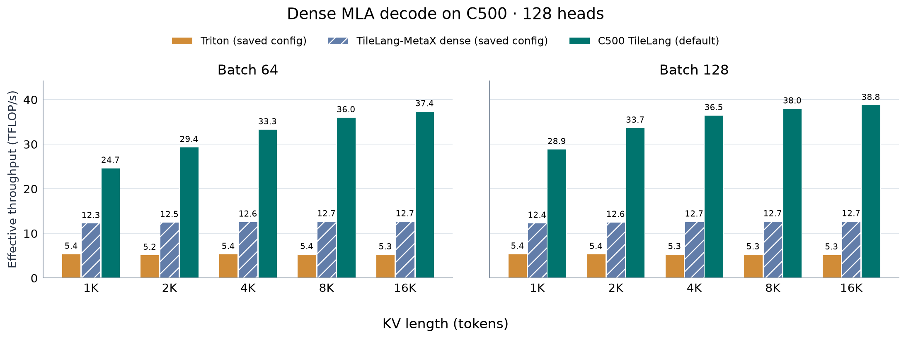
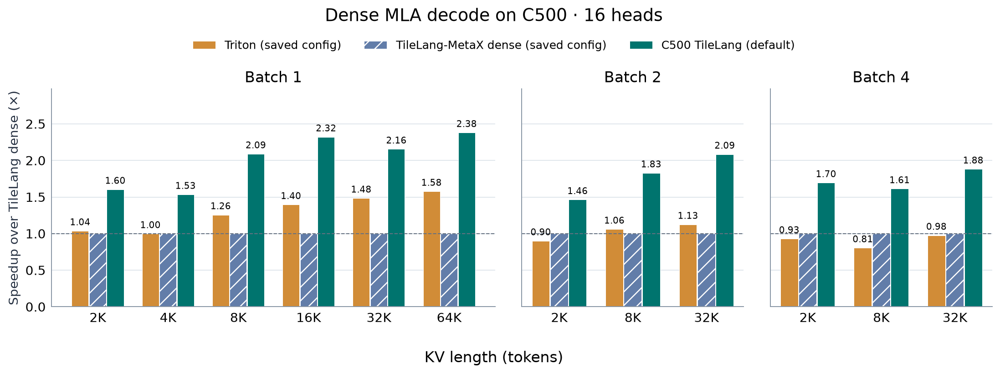

# High-Performance MLA Decode Using TileLang on MetaX C500 GPUs

Building on TileLang’s MLA decode example for NVIDIA Hopper, we present an optimized implementation for MetaX C500 GPUs. We examine how the C500’s matrix instructions and shared memory capacity shape two design choices: how waves divide the output and how many query heads can share a KV tile. [Hopper implementation](../README.md#implementation)

## Architectural Considerations and Optimization Strategies

1. **Matrix instruction granularity.** The Hopper reference implementation uses a WGMMA path with a minimum M dimension of 64 (query heads in single-token decode) across a 128-thread warpgroup, whereas C500’s built-in FP16 MFMA operates on `16×16×16` tiles within a 64-lane wave. For a fixed output width, assigning more query heads to a warpgroup or wave increases the output accumulator and normalization state it holds, while narrow head blocks limit KV reuse. On C500, pairing two 64-lane waves across the output columns and adding wave pairs along query heads expands block-level KV reuse while keeping each wave’s output-tile dimensions and assigned head count fixed as the head tile widens.

2. **Shared memory allocation.** C500 provides a maximum of 64 KiB of shared memory per block (including opt-in), compared with H100’s 227 KiB per-block opt-in limit. Because MLA’s query heads share a single KV head, widening the head tile causes Q storage to grow with the head count while the KV tile size stays fixed. Staging both operands in shared memory therefore limits head-tile width and KV reuse. Keeping KV in shared memory while placing the combined Q tile in register fragments on wider schedules moves the growing query storage out of the per-block shared-memory budget, at the cost of register storage. [H100 resource limits](https://docs.nvidia.com/cuda/hopper-tuning-guide/index.html#occupancy) · [Dense baseline](https://github.com/tile-ai/tilelang-metax/blob/90d49f353ec88bd0d346474f143003d865dd3b79/examples/deepseek_mla/example_mla_decode.py)

   Baseline

   ```python
   Q_shared = T.alloc_shared([block_H, dim], dtype)
   Q_pe_shared = T.alloc_shared([block_H, pe_dim], dtype)
   ```

   Query allocation for wider head tiles

   ```python
   alloc_query = T.alloc_shared if heads == 16 else T.alloc_fragment
   q_tile = alloc_query([heads, dim + pe_dim], dtype)
   ```

The schedule selects the head tile and KV split count together to balance intra-block KV reuse, block parallelism, and the cost of merging partial results.

## Performance Evaluation

Benchmarks use FP16 inputs and contiguous KV storage on a MetaX C500 instance configured with 32,000 MiB of GPU memory. The C500 default is compared with a [Triton reference adapted for contiguous KV](support/triton_reference.py) and a [TileLang-MetaX dense baseline](https://github.com/tile-ai/tilelang-metax/blob/90d49f353ec88bd0d346474f143003d865dd3b79/examples/deepseek_mla/example_mla_decode.py). All results use full-call wall time. The reference configurations were screened on the earlier `f549117c` stack and replayed here without retuning.

**Large batches.** Across 10 shapes with 128 query heads, batches 64/128 and KV lengths 1K–16K, speedup is **4.55–7.38×** over the tested Triton adaptation and **2.01–3.05×** over dense. The figure shows effective throughput.



**Small batches.** Across 12 tested shapes with 16 query heads, batches 1/2/4 and KV lengths spanning 2K–64K, speedup is **1.45–2.00×** over the tested Triton adaptation and **1.46–2.38×** over dense. Bars are normalized to dense = 1; higher is better.



<details>
<summary>Measurement details and reproducibility</summary>

The stack was TileLang-MetaX `dev` revision `90d49f35`, MACA `3.7.1.5`, PyTorch `2.8.0+metax3.7.1.3`, and Triton `3.0.0` with the MetaX backend. The kernel uses the explicit MACA dialect and was tested with the TVM FFI execution backend. Workloads use single-token decode, one KV head, 512 latent dimensions and 64 positional dimensions. Five FP32-reference checks per implementation and shape passed at `atol=rtol=0.002` (330 checks total).

Reported latency is the median of six batch-average timings covering all six implementation-order permutations. Each call includes output/workspace allocation, main kernels and merge, with synchronization at batch end. JIT compilation and configuration search are excluded. Warmups/timed calls per batch are 5/30 for large batches and 200/2,000 for small batches. Effective throughput counts `2 × B × H × N × (576 + 512)` operations per call.

The dense baseline uses 16-head, 32-token configurations. The earlier screening covered dense configurations and Triton head/key tiles, wave counts and splits. [Raw samples, selected configurations, versions and validation errors](figures/benchmark_results.json) cover all 22 shapes.

The sGPU instance reported a 50% compute quota, best-effort scheduling and a 10 ms time slice.

</details>

<details>
<summary>How KV splitting affects the wave partition</summary>

A separate experiment on the earlier `f549117c` stack used a 16,000 MiB C500 sGPU instance with a reported 25% compute quota. Batch 64, 128 heads, 1K tokens, a 64-head tile and 512 threads were fixed. Changing each wave's output tile from the default `16 heads × 256 columns` to `64 heads × 64 columns` reduced full-call latency from 651 to 620 µs at four splits, but increased it from 613 to 1,070 µs at the default two splits. The two-split variant also increased compiled main-kernel private memory from 0 to 700 bytes.

</details>

## Running the example

Start with [the kernel](example_mla_decode_maca.py). The `support/` directory contains a combined benchmark, regression-test and plotting entry point, plus the Triton reference. Report charts and measurements are in `figures/`.

Use this repository's [MACA build](../../../docs/get_started/Installation_maca.md) with matching PyTorch-MACA on C500. The measured backend revision is `90d49f353ec88bd0d346474f143003d865dd3b79`; the standard upstream TileLang wheel does not include MACA. C500 instances are available through the [Moark compute marketplace](https://moark.com/compute).

From this directory, run the correctness smoke test:

```bash
python support/benchmark.py
```

This checks B1/H16 with 2,049 tokens, including a partial final tile, against FP32 using eight random seeds and three stress inputs. It prints a `PASS` summary; the first invocation includes compilation.

For application use, compile with `mla_decode_maca(B, N, query_heads=H)` and call the returned kernel with `(q, q_pe, kv, k_pe, output)`. Pass contiguous FP16 tensors with shapes `[B,H,512]`, `[B,H,64]`, `[B,N,1,512]`, `[B,N,1,64]` and `[B,H,512]`, respectively. H must be divisible by 16 and N ranges from 1 to 65536. Call `.contiguous()` after device or layout conversion.

<details>
<summary>Setup, tests and reproduction commands</summary>

Three-way comparisons additionally require MetaX Triton. For a source build, activate the MACA environment and set:

```bash
export MACA_PATH=/path/to/maca
export PATH="$MACA_PATH/mxgpu_llvm/bin:$PATH"
export PYTHONPATH="/path/to/tilelang-metax${PYTHONPATH:+:$PYTHONPATH}"
```

**Correctness.** Check a custom shape with the default schedule, or run the explicit regression tests:

```bash
python support/benchmark.py --batch-size 2 --heads 32 --kv-length 8193
python -m pytest -q support/benchmark.py
```

The four pytest cases cover partial tiles, single and uneven multiple splits, and shared-memory versus fragment Q. They skip on devices other than C500.

**Performance.** Compare one recorded shape, or reproduce the full 22-shape report on a 32 GB C500:

```bash
python support/benchmark.py --preset compare --output results/compare.json
python support/benchmark.py --preset report --output results/report.json
```

Both commands replay [the saved configurations](figures/benchmark_results.json) using the measurement protocol above. `compare` runs B1/H16/N2048; `report` runs all 22 shapes, or a subset selected by `--report-shapes 1x16x2048`.

The dense reference defaults to this checkout's `examples/deepseek_mla/example_mla_decode.py`. Its source hash must match the [pinned baseline](https://github.com/tile-ai/tilelang-metax/blob/90d49f353ec88bd0d346474f143003d865dd3b79/examples/deepseek_mla/example_mla_decode.py). To select another reference checkout, set `TILELANG_METAX_ROOT` or pass `--baseline-file`; the reference checkout does not need a separate build. The active compiler comes from your Python environment.

Each comparison writes fresh JSON and CSV, including environment information, current source hashes, errors and timing samples. Existing output paths are rejected and partial results are retained on failure.

**Figures.** Regenerate both charts without a GPU (requires Matplotlib):

```bash
python support/benchmark.py --preset plot --output-dir results/published-plots
python support/benchmark.py --preset plot --input results/report.json --output-dir results/new-plots
```

The plotter exports PNG/PDF charts, summary CSV and speedup ranges. It rejects incomplete shape sets, validation records or timing samples; a single-shape comparison cannot generate the full report charts.

</details>
